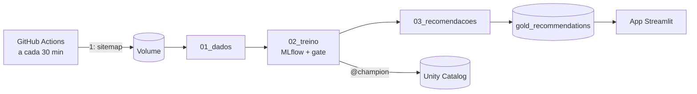

# Recomendação de notícias com MLOps no Databricks

Um recomendador de notícias que **se re-treina sozinho a cada 30 min** e só troca o modelo em
produção quando chegam matérias novas e o novo passa na prova (melhor que o baseline).

- **Dados:** matérias **reais** do sitemap do O Globo + leitores e cliques **sintéticos**.
- **Modelos:** popularidade (baseline) Vs item-CF Vs **híbrido** (recomenda até matéria nova).
- **MLOps:** MLflow, Unity Catalog (`@champion`), quality gate, Job agendado, monitoramento.
- **Entrega:** app Streamlit + CI/CD no GitHub Actions + GitHub configurado com Terraform.



> Detalhes e mais diagramas: [`docs/ARQUITETURA.md`](docs/ARQUITETURA.md).

## Estrutura do projeto

| Pasta / arquivo | Para quê |
|---|---|
| `notebooks/01_dados.ipynb` | sitemap → matérias (`bronze_articles`) + alerta de mudança nos dados (`data_monitoring`) + cliques sintéticos (`silver_*`) |
| `notebooks/02_treino.ipynb` | 3 modelos, MLflow, registro no Unity Catalog e quality gate |
| `notebooks/03_recomendacoes.ipynb` | top-10 de cada leitor (`gold_recommendations`), vizinhos de cada matéria para leitor novo (`gold_similares`) + monitoramento |
| `databricks.yml`, `resources/job.yml` | o Job (3 tasks) descrito em código (Asset Bundle) |
| `app/streamlit_app.py` | o app (aba Tabela Gold: lê a gold, batch; aba Serving Endpoints: chama o endpoint, online; "Monte seu perfil" para leitor novo, também nas duas formas) |
| `.github/workflows/` | `ci.yml` (lint + validação), `cd.yml` (deploy), `ingest.yml` (a cada 30 min, QA e PROD) |
| `infra/github/` | Terraform: repositório, secrets e proteção da `main` |
| `infra/databricks/` | Terraform: schema e Volume de QA e PROD (o dev usa `make setup`) |
| `docs/` | arquitetura, guia do professor, roteiro da aula |

> Todo o código do modelo está **dentro dos notebooks**.

## O que é utilizado no Databricks

| Termo | Em uma linha |
|---|---|
| Workspace | o "site" do Databricks da sua conta |
| Unity Catalog | catálogo de dados e modelos: `workspace.news_recsys_dev.tabela` |
| Volume | pasta de arquivos dentro do catálogo (`/Volumes/workspace/news_recsys_dev/raw/`) |
| Delta | formato das tabelas (Parquet + histórico de versões) |
| Serverless | o compute liga sozinho; ninguém cria máquina |
| Job | notebooks encadeados como tasks, com agenda e histórico |
| Asset Bundle | `databricks.yml`: o Job descrito em código; `make deploy` publica |
| MLflow run | um treino registrado (parâmetros + métricas + modelo) |
| Versão / alias | cada registro do modelo vira versão 1, 2, 3...; `@champion` aponta para a que está em uso |

**Três ambientes, um workspace:**
   - `dev` (o seu, pelo `make`)
   - `qa` (merge na `develop`)
   - `prod` (merge na `main`)
   
> Cada um tem schema, Job, modelo e experimento próprios (`news_recsys_<ambiente>`; no dev, um por pessoa: `news_recsys_dev_<usuário>`). Qualquer comando do `make` aceita `TARGET=qa` ou `TARGET=prod`.

## Data Lake Vs Data Warehouse Vs Dala Lakehouse

> PS: Databricks é conhecido por sua arquitetura de Data Lakehouse, mas se encaixa nos três cenários.

| Característica | Data Lake | Data Warehouse | Data Lakehouse |
| --- | --- | --- | --- |
| Objetivo | Armazenar dados brutos | Integrar, transformar e organizar dados para análise | Armazenar e analisar dados no mesmo ambiente |
| Formatos de dados | Estruturados, semiestruturados e não estruturados | Principalmente tabelas estruturadas | Diversos formatos, com suporte a tabelas gerenciadas |
| Custo de armazenamento | Geralmente baixo (S3/ADLS) | Geralmente mais alto, dependendo da plataforma | Geralmente baixo (S3/ADLS) |
| Performance em SQL/BI | Depende do motor e da organização dos dados | Alta, otimizada para consultas analíticas | Alta, com otimizações e tabelas gerenciadas |
| Suporte a IA e Data Science | Excelente para dados brutos e diversos formatos | Bom para dados estruturados | Excelente para dados brutos e estruturados |
| Transações ACID | Não nativas para arquivos comuns | Geralmente suportadas nativamente | Disponíveis via formatos de tabela compatíveis |
| Governança e qualidade | Exigem configuração adicional | Geralmente integradas ou suportadas pela plataforma | Podem ser integradas por meio de catálogo, regras e metadados |
| Duplicação de dados | Pode ocorrer entre ferramentas | Pode exigir cópias para carga e análise | Pode reduzir cópias ao compartilhar os mesmos dados |

## Modelos de ML utilizados nesse projeto

| Modelo | Como funciona | Personalização | Matérias novas (cold start) |
| --- | --- | --- | --- |
| Popularidade (baseline) | Recomenda as matérias mais lidas no treino. | Não; mesma lista, excluindo matérias já lidas. | Não; matérias sem cliques têm pontuação zero. |
| Item-CF | Recomenda matérias semelhantes às já lidas, usando similaridade de cosseno entre leitores. | Sim; pontua cada matéria pela similaridade com o histórico do leitor. | Não; depende de interações anteriores. |
| Híbrido | Combina 40% Item-CF e 60% conteúdo (TF-IDF de título e editoria), com meia-vida de 24 h na parte de conteúdo. | Sim; usa histórico de leitura e características textuais. | Sim; o conteúdo permite pontuar matérias sem cliques anteriores. |

> Baseline: referência mínima que o modelo vencedor precisa superar no gate de avaliação.

### Entendimento das métricas utilizadas

* `ndcg_10`: Normalized Discounted Cumulative Gain de posição 10
* `hit_10`: HitRate de posição 10
* `hit_fria_10`: cold-start evaluation (nome da var é nosso)

| Métrica | O que mede | Interpretação |
| --- | --- | --- |
| `ndcg_10` | Acertos e sua posição no ranking, valorizando os primeiros lugares. | Varia de 0 a 1. Métrica principal para escolher o vencedor e avaliar o gate. |
| `hit_10` | Se pelo menos uma matéria recomendada está entre as lidas no teste. | Média de 0 a 1, indicando a proporção de leitores com pelo menos um acerto no Top-10. Ignora posição e quantidade de acertos. |
| `hit_fria_10` | Se o Top-10 contém pelo menos uma matéria fria (sem cliques no treino) que o leitor leu no teste. | Média calculada apenas para leitores que leram matérias frias no teste. Mede a capacidade de recomendar notícias novas. |

## Mão na massa

**Antes de tudo: Instalação (macOS, Linux e Windows)**

| Sistema | Antes de começar |
|---|---|
| macOS | `xcode-select --install` |
| Linux (Ubuntu/Debian) | `sudo apt install -y python3 python3-venv make curl unzip git jq` |
| Windows | PowerShell como administrador: `wsl --install -d Ubuntu-24.04`, depois use o terminal do Ubuntu |

```bash
make doctor        # confere o que está instalado
```

1. Conta Free Edition: <https://www.databricks.com/learn/free-edition>.

2. Token: avatar → **Settings** → **Developer** → **Access tokens** → *Generate new token*.

3. No terminal, na pasta do projeto:
```bash
make db-install
make db-configure      # URL do workspace + token
make setup             # Cria o unity catalog
make deploy            # Upload dos notebooks + Cria o Job no workspace
make run               # databricks.yml + resources/job.yml: executa Jobs & Pipelines 
```

4. Para visualizar as recomendações, vai em **SQL Editor**:
```sql
WITH lidas AS (
SELECT u.persona, a.section, count(*) AS n
FROM workspace.news_recsys_dev_<seu_usuario>.silver_clicks c
JOIN workspace.news_recsys_dev_<seu_usuario>.silver_users u USING (user_id)
JOIN workspace.news_recsys_dev_<seu_usuario>.bronze_articles a USING (url)
GROUP BY ALL
),
recomendadas AS (
    SELECT u.persona, g.section, count(*) AS n
    FROM workspace.news_recsys_dev_<seu_usuario>.gold_recommendations g
    JOIN workspace.news_recsys_dev_<seu_usuario>.silver_users u USING (user_id)
    GROUP BY ALL
)
SELECT persona, section,
        round(100 * coalesce(l.n, 0) / sum(l.n) OVER (PARTITION BY persona), 1) AS pct_lidas,
        round(100 * coalesce(r.n, 0) / sum(r.n) OVER (PARTITION BY persona), 1) AS pct_recomendadas
FROM lidas l
FULL JOIN recomendadas r USING (persona, section)
QUALIFY pct_lidas >= 5 OR pct_recomendadas >= 5
ORDER BY persona, pct_lidas DESC
```

5. Serving Endpoints: Consumindo modelo por inferência (depende do caso de uso)
```bash
make tf-serving-plan tf-serving-apply
```
```bash
make predict                                  # leitor conhecido (LEITOR=u_000)
```
```bash
make predict LIDAS=<url1>,<url2>              # perfil de leitor novo: as matérias que ele leu
```
> O endpoint sempre serve a versão `@champion`; com *scale to zero*, a 1ª chamada após um tempo parado demora.

6. Volta para o **terminal** e executa:
```bash
make install
cp app/.streamlit/secrets.toml.example app/.streamlit/secrets.toml  # preencha o arquivo
make app
```
> Realize os testes locais e veja se está funcionando

7. **GitHub (uma vez):** cria o repositório e liga a esteira.
```bash
make gh-login
```
```bash
make gh-repo
```

8. **Permissões para o Token do GitHub**
```yml
# TF_GITHUB_TOKEN: Settings → Developer settings → o token → Edit → Repository access
7.1: **Repository access:** *Only select repositories* → `will3g/news-recsys-databricks`
7.2: **Permissions → Repositories → + Add permissions:**
7.3:
.---------------------------------.
| Permissão      | Acesso         |
|----------------|----------------|
| Administration | Read and write |
| Environments   | Read and write |
`---------------------------------´
7.4: *Generate token* (ou *Update*), e copie o valor.
```

9. Secrets e primeiro push:
```bash
make gh-secrets
```
```bash
make gh-push
```

10. **Acompanhe a esteira** em **Actions** → `cd` (develop = QA, main = PROD):
```yml
infra (Terraform: GitHub + Databricks) → databricks (snapshot + deploy + run, ~5 min) → serving (endpoint @champion) e streamlit, em paralelo
```
> Se não disparar: **Actions** → `cd` → *Run workflow* → escolha a branch.

11. **Streamlit Cloud (2 apps):** <https://share.streamlit.io> → *Create app* → *Deploy a public
    app from GitHub*:
```bash
┌────────────────┬───────────────────────────────┬───────────────────────────────┐
│     Campo      │            App QA             │           App PROD            │
├────────────────┼───────────────────────────────┼───────────────────────────────┤
│ Repository     │ will3g/news-recsys-databricks │ will3g/news-recsys-databricks │
├────────────────┼───────────────────────────────┼───────────────────────────────┤
│ Branch         │ develop                       │ main                          │
├────────────────┼───────────────────────────────┼───────────────────────────────┤
│ Main file path │ app/streamlit_app.py          │ app/streamlit_app.py          │
├────────────────┼───────────────────────────────┼───────────────────────────────┤
│ App URL        │ will3g-news-recsys-homolog    │ will3g-news-recsys            │
└────────────────┴───────────────────────────────┴───────────────────────────────┘
```

12. **Secrets de cada app:** *Advanced settings* (ou **Manage app** → ⋮ → *Settings*) → *Secrets*.
    A linha `[databricks]` é obrigatória:
```bash
# EX: http_path = "/sql/1.0/warehouses/a72a5e4a3480ab26" (SQL -> SQL WAREHOUSE)

[databricks]
server_hostname = "<host>.cloud.databricks.com"
http_path = "/sql/1.0/warehouses/<sql-warehouse-http-path-id>"
access_token = "token"
catalog = "workspace"
schema = "news_recsys_<qa|prod>"
```
> Depois: **Manage app** → ⋮ → *Reboot app*.

13. Destruir todo o ambiente provisionado
```bash
make db-destroy
make db-destroy TARGET=qa
make db-destroy TARGET=prod
make gh-destroy
```

## Custos

R$ 0: Databricks Free Edition, GitHub Actions (repo público) e Streamlit Community Cloud.

## Limitações conhecidas

- Os cliques são **sintéticos**: as métricas medem o padrão das personas, não leitores reais.
- O state do Terraform fica num Volume do Databricks e não guarda tokens (os secrets são criados pelo `make gh-secrets`).
- O token do Databricks expira: renove no GitHub (`make gh-secrets`) e no Streamlit Cloud.
